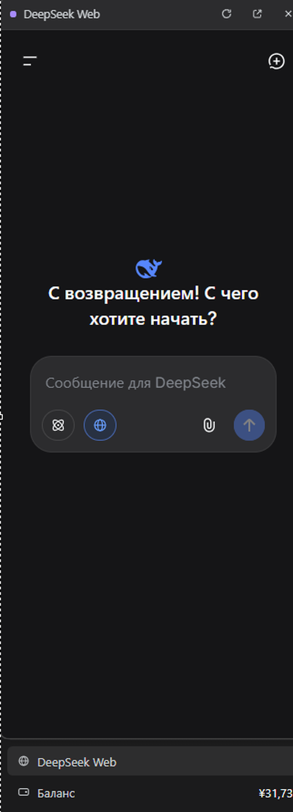

# dsh-web-deepseek

DeepSeek Web in a small window that opens from a row **above the sidebar balance** in
[DeepSeek Harness](https://github.com/deepseek-ai/deepseek-harness) Desktop.

It is the real `chat.deepseek.com` with your own account: trivial questions spend **browser usage
limits instead of API tokens** and never enter the agent's conversation, so they cannot inflate the
context (and the bill) of the session you are working in.



## What you get

- A `DeepSeek Web` row in the sidebar footer, directly above the balance chip, in the wide sidebar
  and in the collapsed rail.
- Click it: a compact window opens above the row with the real DeepSeek web chat inside.
- Header: status dot, reload, open in the system browser, close. `Escape` closes the window while
  focus is on its own controls. Links that the page opens in a new window stay inside this window,
  so its sign-in is not lost.
- A local prompt composer under the page: type a rough thought, then press **Thought**, **Prompt**
  or **Text**. Each button copies a shaped request — the prompt one builds a structured agent
  prompt (role, context, task, constraints, expected result, format) — and you paste it into the
  DeepSeek page. No model is called for those templates.
- Closing or collapsing the sidebar closes the window; the next open reloads the site.

## Why not an iframe?

`chat.deepseek.com` answers with `Content-Security-Policy: frame-ancestors 'none'`, so no page can
iframe it. The Desktop shell owns a sandboxed `<webview>` guest for exactly this case (the same
mechanism as the built-in right-sidebar Browser), and the plugin asks that shell for a guest lease.
A browser-only Harness has no such bridge, so there the row opens the site in a tab instead.

## Requirements

- **DeepSeek Harness Desktop.** A browser-only Web profile cannot embed the page.
- Tested with DeepSeek Harness `0.2.2-rc.5` on Windows. The plugin uses the desktop guest bridge
  (`globalThis.dshDesktop.browser`), which is internal to the desktop shell and may change in a
  future release. Not affiliated with DeepSeek.

## Install

**From GitHub, one command** (the bundle installs straight from this repository and is pinned to a
commit):

```sh
dsh plugin --profile desktop add github:menhaiez/dsh-web-deepseek
```

**From a checkout** (no npm required):

1. Clone this repository.
2. **Settings → Plugins → Add plugin → Install from directory** and pick the checkout.

Either way, reload the page afterwards (Application menu → **Reload Page**) or restart the app.
The row appears above the balance; click it and sign in once.

The package is not published on npm yet; when it is, `dsh plugin --profile desktop add
dsh-web-deepseek` will work as well.

## Limits

- **Sign in once per app run.** The desktop guest uses a process-lifetime storage partition, so
  after restarting DeepSeek Harness the page asks you to sign in again. Within one run the sign-in
  survives closing and reopening the window.
- **Nothing is automated.** The plugin does not type into the page, click Send or read answers: the
  composer buttons only copy text. That keeps it independent of DeepSeek's DOM.
- The guest policy blocks popups (they are handed back to the window), downloads, permission
  prompts, and navigation to the Harness host. DeepSeek's own copy button may be affected by the
  blocked clipboard permission; select the text instead.
- DeepSeek's web app is not covered by a compatibility promise and may change at any time.
- The page receives no Harness DOM, storage, API or Node access.

## How it works

- The bundle registers one row in the root-scoped `sidebar.footer.action` slot with `order: 5`, so
  it renders above the balance row (`order: 10`). The footer seat is a flex row, so the row claims
  its own line in CSS.
- The window is a `position: fixed` surface anchored to the row's rectangle, measured on open and
  on resize; it closes when the row disappears.
- Opening acquires an Electron guest lease from the desktop preload bridge, creates the
  `<webview>` with the approved partition, and loads the site. Unmounting removes the guest and
  releases the lease.

## Verify

The bundle has no build step and no runtime dependencies. Offline checks (manifest, patch, locale
JSON, icon, module registration):

```sh
node verify.cjs
```

## Русский

Строка **DeepSeek Web** над балансом открывает настоящий `chat.deepseek.com` в маленьком окне:
свой аккаунт, лимиты браузерной версии, без API-токенов и без раздувания контекста сессии.
Внизу окна — конструктор запросов: мысль, промпт для агента, короткий текст; кнопки копируют
готовый запрос, вставляете в окно через Ctrl+V. Работает только в приложении Desktop; вход нужен
один раз за запуск приложения. Ничего не автоматизирует и не хранит.

## License

MIT
